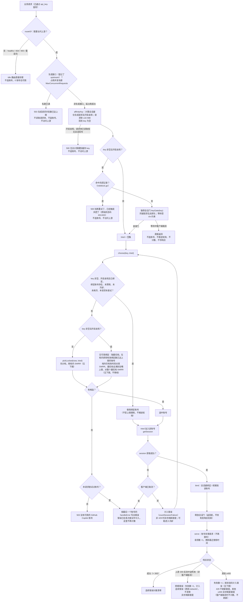
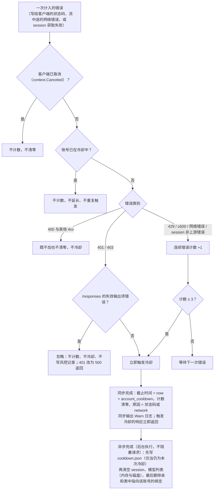
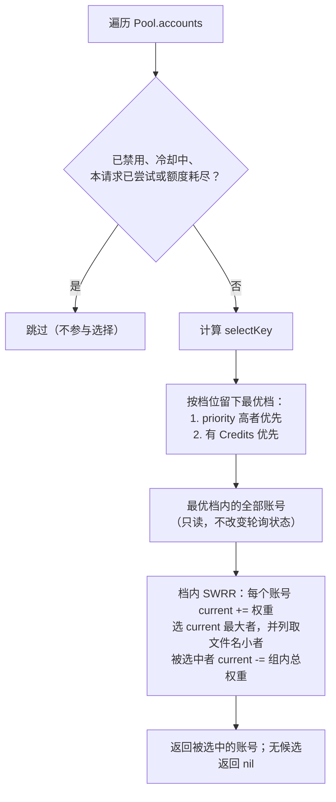

# 账号池：选择、故障切换与冷却

代码：`internal/copilot/pool.go`（`forward`、`pickSession`、`record`、`choose`）、`cooldown.go`（错误计数、冷却与持久化，`setCooldown`/`available`）、`affinity_gate.go`（会话门）、`weight.go`、`service.go`。

## 结构与构造

- `Pool.accounts []*poolAccount` 保持插入顺序：启动时为凭证文件名顺序，管理接口新增的追加到末尾。ID 只用于查找与唯一性。
- `poolAccount`：`id`、`service *Service`、`routes`、`disabled`、`priority`、`swrrCurrent`（轮询状态）、`cooldown`（冷却时长）、`affinity`（会话绑定表，冷却时清理用）、`errs`（连续错误计数与冷却原因，见 `cooldown.go`）、请求统计、额度缓存。各账号的 session 与缓存相互独立。
- 被选中的账号指针在请求期间独立使用，删除账号不影响进行中的请求。

```go
NewPool(configs []Config) (*Pool, error)   // 亲和与管理关闭，至少 1 个账号（主要给旧测试）；冷却固定为缺省值
NewManagedPool(PoolConfig, []PoolAccount) (*Pool, error)
```

- `PoolConfig`：`APIKey`、`ManagementKey`、`CredentialsDir`、`Host`（顶层覆盖）、`CacheDir`（测试须指向 `t.TempDir()`）、`ModelsCacheTTL`、`SessionAffinityTTL`（≤0 关闭亲和）、`SessionAffinityMaxPerAccount`（每账号有效绑定数上限，≤0 不限制；缺省 5 由 cmd 层设置，见 `session-affinity.md`）、`AccountCooldown`（账号冷却时长，≤0 使用 `DefaultAccountCooldown` = 2 小时；cmd 层由 `account_cooldown` 设置，见 `config.md`）、`MaxConcurrentRequests`（生成请求并发上限，≤0 不限制；缺省 32 由 cmd 层设置，见下文「分发」流程）、`Client`（测试注入）、`Logger`。
- `(*Pool).WaitCooldownEffectsTimeout(d) bool`：最多等待 d，等待进入冷却的异步副作用（清空缓存、删除绑定、写 `cooldown.json`）全部结束；超时返回 false。cmd 层关闭时使用（`d` 为 5 秒，见 `config.md`）。`(*Pool).WaitCooldownEffects()` 无上界，供测试使用。
- `APIKey` 必填（失败即拒绝）：`New`、`NewPool`、`NewManagedPool` 在 `APIKey` 去首尾空白后为空时返回错误；`requireAPIKey` 收到空密钥时拒绝除 `/healthz`、`/favicon.ico` 外的所有请求，`requireManagementKey` 收到空管理密钥时同样拒绝（空密钥与空请求头的哈希相同，不能交给 `secretMatches` 比较）。库层只要求非空，32 字节的长度下限由 cmd 配置层（`loadConfig`）强制。
- `PoolAccount`：`Token`、`Host`、`User`（必填）、`Disabled`、`Priority`。
- `NewManagedPool`：`APIKey` 为空时返回错误；仅 `ManagementKey` 非空时允许 0 账号；账号重复（Host+Token 相同）或用户名忽略大小写重复、`ManagementKey` 与 `APIKey`（去首尾空白）相同、用户名不合规，均返回错误。

## 流程图

### 请求分发与故障切换（`dispatch` → `forward`）



生成请求占用的并发名额在 `dispatch` 返回时释放（流式响应写完之后），因此名额覆盖整个流式响应的时长。名额只用缓冲 channel 做信号量，不排队等待；名额已满时立即 503，与账号选择、会话亲和互不影响。
生成响应向客户端写入时每次写入都续期 60 秒的写超时（`generationWriteTimeout`，见 `http-api.md`）：客户端长时间不读取导致写超时后，请求结束并释放名额，因此一个不读取响应的客户端不会永久占用名额。

同一会话键的选择、取 session、绑定由 `pickSession` 在会话门（`keyGate`）内串行执行，后到的同键请求等待先到者完成绑定后再选账号（见 `session-affinity.md`「选择规则」）。门在成功绑定之后、`serve` 之前释放；全部失败（503 或最后账号的错误）与客户端取消时，门在 `pickSession` 返回前释放（`defer`），错误响应在门外写入。等待门时客户端取消则直接返回，不选账号、不推进轮询、不写响应。等待时长受请求 ctx 约束、没有服务端总超时，最坏约为账号数 × 单次取 session 超时（30 秒），细则见 `session-affinity.md`。亲和关闭或键为空时不加门。

### 错误计数与进入冷却（`countFailure`，`cooldown.go`）



成功（状态 < 300）清零连续错误计数。`countFailure` 在 `errs.mu` 内完成判定与设置截止时间，不做 IO；副作用在锁外启动，之后的文件读写由 `fileMu` 串行化。

## 账号选择

`pickLocked(now, tried)`（调用方持有 `Pool.mu`）。候选为未禁用、**未冷却**、未耗尽且本请求未尝试过的账号。冷却中的账号完全不参与选择，没有任何兜底；全部账号不可用时返回 503。先按以下顺序分档，取最优档：

1. `priority` 高者在前。
2. 有 Credits 者在前（`weigh`，`weight.go`）：主额度是第一个非 `additional_budget` 的额度窗口；剩余比例 > 0 为"有 Credits"档；否则取 `additional_budget` 比例，档位"无 Credits"；无额度数据为（无 Credits，0）。

- 额度耗尽（`exhaustedUntil`，`weight.go`）：缓存额度中主额度的剩余比例不大于 0，且 `additional_budget` 窗口不存在或剩余比例不大于 0，主额度的重置时间可解析时，账号不参与选择（无论优先级多高），直到重置时刻（含）之后自动恢复。重置时间为 RFC3339 时按其时刻，为 `YYYY-MM-DD` 时取该日期 UTC 0 点；主额度没有重置时间或无法解析时不跳过。

档内（优先级相同、同为有 Credits 或同为无 Credits）按平滑加权轮询（SWRR，算法同 nginx）选择：

- 权重 `swrrWeight()` 为 `max(1, round(剩余比例 * 100))`，剩余比例即 `weigh` 得到的比例；无额度数据、比例为 0 或取整后不足 1 时权重为 1。
- 每次选择时，组内每个账号的 `swrrCurrent` 加上自己的权重；选 `swrrCurrent` 最大者，并列时取凭证文件名（`User+".json"`，无用户名用 ID）字节序最小者；被选中者的 `swrrCurrent` 再减去组内总权重。
- 只修改组内成员的 `swrrCurrent`，因此最优档之外的账号状态不变。
- 命中会话绑定时直接使用绑定账号，不推进轮询，也不受每账号绑定上限限制（见 `session-affinity.md`）。绑定账号冷却中时视为不可用，改为无可用绑定的选择。
- 无可用绑定的会话（新会话或故障切换）且键非空、开启亲和时，先取最优档，再在最优档内排除有效绑定数已达 `SessionAffinityMaxPerAccount` 的账号，对剩余账号做 SWRR。最优档全满时忽略上限，对整个最优档做 SWRR，因此上限绝不会把新会话降到低优先级或无 Credits 档，也不会因此返回 503；冷却账号本来就不是候选，因此上限也不会把会话推向冷却账号。`SessionAffinityMaxPerAccount <= 0` 时不排除；键为空或关闭亲和时上限无效。细则见 `session-affinity.md` 的「绑定上限」。

其他说明：

- 权重与耗尽判断只读账号的额度缓存，不访问上游，额度只在刷新后变化（见 `quota-stats.md`）。额度由后台定时刷新保持新鲜（无需打开控制台，与是否配置 `management_key` 无关），账号请求失败（非 429）时还会异步刷新该账号的额度；因此一次失败后，该账号的额度可能立即变为耗尽并被跳过。启用 `management_key` 后仍可在控制台强制刷新额度。
- 无可选账号（0 个、全部禁用、全部冷却，或全部耗尽未到重置时刻）时，需要账号的请求直接返回 503（`没有可用的 GitHub Copilot 账号`），不访问上游。
- `/healthz`、404、405、重定向不访问上游，由池直接处理，0 账号也能工作。
- 模型列表是各账号独立获取的；订阅不同时某模型可能只在部分账号可用，被分到不支持的账号会返回 400。

### 分档与轮询（`pickLocked`）



说明：同档账号按 SWRR 轮流被选中，权重越大出现越频繁（例如权重 5:1:1 时连续选择的序列为 a a b a c a a）。轮询状态只在内存中，任何时候都不重置；档位之间是严格的先后关系，低档账号只有在高档没有候选时才会被选中。无可用绑定的会话还会在最优档内排除已达每账号绑定上限的账号，最优档全满时忽略上限，不降档（见上文「账号选择」与 `session-affinity.md`）。

## 故障切换

- 会话已绑定账号时优先使用；该账号禁用、冷却、耗尽或本请求已尝试过时，改为无可用绑定的选择（先取最优档，在档内排除已达上限的账号，再 SWRR，见 `session-affinity.md`）。
- 取得 session 之后账号可能已因另一个请求的错误进入冷却：此时不绑定会话键，本次请求仍由该账号处理（它在冷却前已被选中，属于在途请求），之后的请求不会再选中它。
- 仅模型列表与生成请求（chat completions、responses、`/v1/messages`）在 session 获取失败（网络错误、上游错误响应、无效 session）时切换：该次失败计入账号的连续错误（按状态码规则，见下文），同请求改用未尝试过的账号（冷却中与耗尽的账号不参与），每个账号每请求最多尝试一次，全部失败返回最后一个账号的错误。session 失败不再造成 1 分钟的短冷却。
- 生成请求失败后不会在其他账号重发。

## 限流、错误计数与冷却

错误计数的判定规则（代码见 `cooldown.go`）：

- 计入的错误：写给客户端的响应状态 401、403、429、≥500，以及网络错误与 session 获取失败。生成接口的网络错误（请求上游时的非上游错误）写给客户端为 502，但冷却原因记为 `network`，不是 `502`；上游真实返回的 502 仍按 `502` 计入。session 获取阶段的非上游错误按网络错误计入。
- 错误状态（>= 400）的正文读取失败按上游状态码计数，不计为网络错误：上游 401/403 的正文读不完整时仍一次冷却（原因 `401`/`403`）；429 与 5xx 仍按连续错误计数（原因为该状态码）；400 与其他 4xx 既不计数也不清零。适用于生成接口（流式与非流式）、session 交换与模型列表的错误响应。生成接口的上游 400 正文读取失败时写给客户端 400（不是 502），同样不计数。
- 上游错误响应的转发：原样返回上游的状态码与正文，不转发 `Content-Length`（正文可能读取不完整，声明的长度会让客户端读取出错）。正文为空或读取失败时写出 JSON 错误体（格式与其他错误响应一致，说明上游返回该状态但正文读取失败）。正文读取中途失败时，原正文丢失，客户端收到的是保留上游状态码、格式完整的 JSON 错误体，而不是截断的正文。
- 上游的非错误状态（3xx，例如模型列表接口返回重定向）：既不计数也不清零，也不计为网络错误。它仍以 502 写给客户端（这是既有的写出方式），但计数规则为忽略。
- 流中途失败：上游已返回成功状态（< 400）之后读取上游流出错（非客户端取消）计为网络错误（原因 `network`），计数不清零。
- 客户端写入失败（含写超时）：上游已返回 200，写给客户端失败视为成功并清零连续错误计数（不计为错误，也不保留之前的计数）。客户端取消既不计数也不清零。
- 不计入：400 以及其他 4xx（404、413、422 等），既不加也不清零；客户端取消（`context.Canceled`）不计入。
- 成功（状态 < 300）清零连续错误计数。
- 例外：上游 `/responses` 因输出项绑定在原连接上而拒绝回放（401 `does not belong to this connection`，或 400 `encrypted content … could not be verified`，见 `http-api.md`）是请求内容问题，不是账号凭证问题。`Service` 清理后重试一次；无法重试或重试后仍失败时，返回上游响应（401 改为 500，正文不变，避免服务前端因过多 401 封禁客户端 IP；400 不变），并在响应写入器上标记 `failureIgnored`（经 `generationWriter` 的 `Unwrap` 传到 `statusResponseWriter`），因此既不计入账号的 `errors`，也不计入连续错误（不加也不清零），401 也不冷却、不写风控记录（`recordRisk` 因未进入冷却而不触发）。重试成功得到的响应按其状态码照常处理。
- 401 或 403 一次即冷却（账号已在冷却中则不计，见下；上一条的失效输出项错误除外）。其他计入的错误（429、5xx、网络错误、session 获取失败）连续第 3 次触发冷却。
- 触发冷却后计数清零；账号已在冷却中时再出错不延长冷却、不重复触发、不计数。
- 同一请求只计一次：session 获取失败在 `pickSession` 中计入；若该账号是最后一个尝试的账号并经 `handleError` 写出错误，`forward` 只更新统计，不再计数。
- 错误响应原样返回客户端，包括触发冷却的那次请求（429 原样流式透传，不在本请求内换号）。

冷却：

- 时长由 `account_cooldown` 配置（缺省 `2h`，见 `config.md`），库层 `PoolConfig.AccountCooldown <= 0` 时使用 `DefaultAccountCooldown`。原来的 1 分钟短冷却已取消。
- 冷却期间账号完全不参与选择（与额度耗尽一样跳过），会话绑定指向冷却账号时视为不可用；全部账号不可用时返回 503。
- 冷却原因 `reason`：触发那次错误的状态码字符串（如 `401`、`403`、`429`，上游真实返回的 `502`），网络错误等无状态码时为 `network`。
- 进入冷却时，截止时间与原因的设置、计数清零同步完成，并同步输出一条 Warn 日志（含账号、原因与截止时间（RFC3339），不含 token），触发冷却的响应立即返回。随后的副作用在后台异步执行，不阻塞请求，也不随请求取消，顺序固定：
  1. 先写入 `cooldown.json`（在 `fileMu` 内，且仅当冷却仍有效时写入），使崩溃时冷却不丢失；
  2. 清空该账号的 session（内存与磁盘）与模型列表（内存与磁盘）：先取得对应的缓存锁（等待在途请求结束），再检查冷却仍有效；
  3. 删除会话亲和表中指向该账号的全部绑定（亲和表的保存方式不变，见 `session-affinity.md`）。
  破坏性步骤执行前都检查账号仍处于本次冷却（截止时间仍为本次值）；已被解除则跳过，因此解除后不会清掉解除后新写入的 session 或绑定。
  保留额度缓存（`quota.json`）与请求统计。服务关闭时最多等待 5 秒这些副作用结束（`Pool.WaitCooldownEffectsTimeout`，见 `config.md`），之后照常保存亲和表。
- 在途请求（冷却前已选中）不会把 `session.json`、`models.json` 写回磁盘：冷却期间跳过这两类缓存的写入；内存中的结果仍会更新，之后的异步清空会把它清掉。
- 异步副作用的写入通过 `fileMu` 串行化：写入 `cooldown.json` 前在锁内确认冷却截止时间仍等于本次冷却，已被解除或已被新冷却取代时跳过，使迟到的副作用不会让已解除的冷却复活。
- 冷却截止时刻到达后账号重新参与选择，视图中的冷却与原因随之消失，连续错误计数从 0 开始。
- 持久化：`cooldown.json` 位于账号缓存目录，内容为 `{"until":"RFC3339 时间","reason":"403"}`（截止时间为秒精度），权限 `0600`。创建账号时（启动或管理接口导入）：截止时间晚于当前时间则继续冷却；已过期或文件不存在则忽略；内容损坏时记录 Warn 并删除该文件，之后启动不再重复告警。没有缓存目录时冷却只在内存中，重启后清空。清空缓存（进入冷却时清理 session 与模型列表）不会删除 `cooldown.json`。
- 手动解除：`PATCH /v0/management/accounts` 带 `clear_cooldown: true`（见 `management.md`）。顺序：先写凭证（`disabled` 或 `priority` 有变化时）；写入失败返回 500，冷却、`disabled`、`priority` 全部不变。写入成功后同步内存中的 `disabled` 与 `priority`，再解除冷却：
  - 在 `fileMu` 内删除 `cooldown.json`（仅当截止时间仍为读取时的值）。删除失败返回 500，错误信息说明“凭证已更新，账号仍冷却”，此时 `disabled` 与 `priority` 已生效，冷却不变。
  - 删除成功后以 `CompareAndSwap(读取时的截止时间, 0)` 清除内存中的冷却，并清空原因与计数。若期间已产生新的冷却（截止时间已变化），则不清除新冷却，请求仍返回 200，账号保持冷却，新冷却的记录由其副作用写入。
  禁用、启用与调整优先级本身不影响冷却状态。
- 客户端取消不冷却也不计错误。

## 风控记录（`riskblock.go`）

- 记录：开启会话亲和时，生成请求（会话键非空）的 401/403 使账号**本次进入冷却**时，记录该会话键与状态码，有效期固定 2 天（`riskBlockTTL`，命中不续期）。两条路径都会记录：账号处理请求时写给客户端的 401/403（`serve` → `record`），以及 `pickSession` 中 session 交换返回 401/403（之后本请求照常切换到其他账号）。账号已在冷却中（未触发新冷却）、`/responses` 的失效输出项错误（见上文例外）、429/5xx/网络错误累计触发的冷却、键为空或关闭亲和时都不记录。
- 拦截：`forward` 在会话门与选账号之前检查记录；命中时直接返回 500 与 `{"error":{"message":"别再重试了，已经触发风控了（原始状态码 403）","type":"copilot_proxy_error"}}`（括号内为记录的 401/403），不选账号、不访问上游、不计入任何账号的统计，并输出 Warn「风控：会话已被拦截」（只含键前 12 字符）。不同会话键互不影响；无会话键的请求（模型列表等）不受影响。
- 持久化：`<CacheDir>/risk_blocks.json`，`{"version":1,"blocks":[{"key","status","expires"}]}`，权限 `0600`。新增记录时在请求返回前同步写入（只写未过期项，并清理内存中的过期项）；写入失败只记 Warn。池创建时加载：丢弃已过期、key 为空、状态码不是 401/403 的项，截止时刻封顶 `now+2天`；文件损坏或版本不符时 Warn「风控：记录文件无法加载，已以空表启动」。`CacheDir` 为空时只在内存中。
- 手动解除账号冷却（`clear_cooldown`）不清除风控记录；记录只能等待过期，或停止服务后删除 `risk_blocks.json`。

## 测试依赖的内部名字

`riskTable`（`newRiskTable`、`add`、`lookup`、`save`、`load`）、`riskBlockTTL`、`riskBlockMessage`、`riskBlockFileName`、`Pool.risk`、`(*Pool).gate`、`keyGate`（字段 `mu`、`m`）、`gateEntry.waiters`、`Pool.accounts`、`pickLocked(now, tried map[*poolAccount]bool)`、`(*Pool).choose(key string, tried map[*poolAccount]bool)`、`(quotaWeight).swrrWeight() int`、`DefaultSessionAffinityMaxPerAccount`、`PoolConfig.SessionAffinityMaxPerAccount`、`(*affinityTable).activeCounts(time.Time) map[string]int`、`MinPriority`/`MaxPriority`、`quotaWeight`/`weigh(*Quota)`、`exhaustedUntil(*Quota)`、`(*poolAccount).exhausted(time.Time) bool`、`DefaultAccountCooldown`、`PoolConfig.AccountCooldown`、`(*Service).setCooldown(time.Time)`/`available(time.Time) bool`（`cooldown.go`）、`(*poolAccount).record`、`(*Pool).findAccount(id)`（忽略大小写）、`(*Service).cacheDir`、`(*Pool).Handler()`、`generationWriteTimeout`；额度刷新相关的 `DefaultQuotaRefreshInterval`、`(*Service).quotaRefreshInterval`、`quotaRefreshTick`、`quotaErrorRefreshInterval`、`quotaRefreshTimeout`、`(*Pool).RunQuotaRefresh(ctx)`、`(*poolAccount).refreshAfterError()`、`quotaCache.refreshing`；测试辅助 `testClient`、`testJSON`、`testService`、`testDevice`（login_test.go）、`poolUpstream`（pool_test.go）、`quotaTimeoutMessage`（management_review_test.go）。其余名字见 `session-affinity.md`、`quota-stats.md`、`management.md`。
