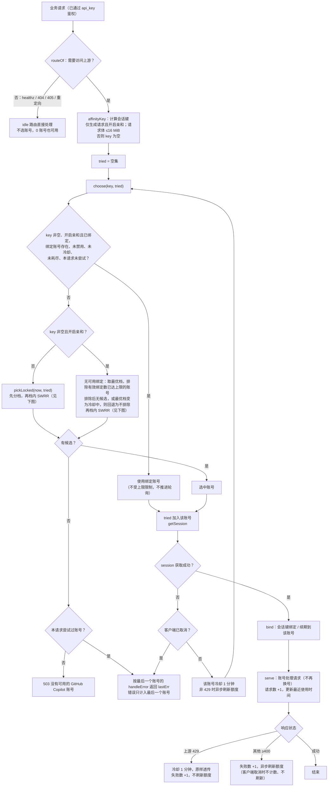
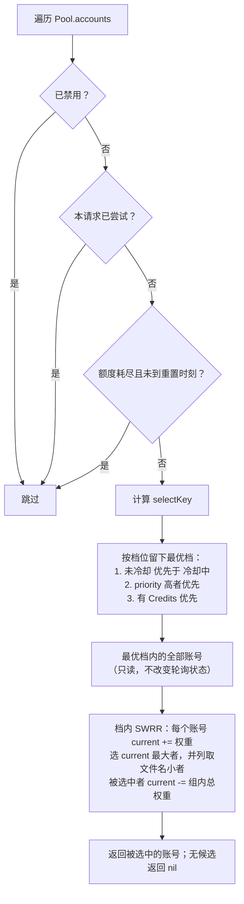

# 账号池：选择、故障切换与冷却

代码：`internal/copilot/pool.go`、`weight.go`、`service.go`（`setCooldown`/`available`）。

## 结构与构造

- `Pool.accounts []*poolAccount` 保持插入顺序：启动时为凭证文件名顺序，管理接口新增的追加到末尾。ID 只用于查找与唯一性。
- `poolAccount`：`id`、`service *Service`、`routes`、`disabled`、`priority`、`swrrCurrent`（轮询状态）、请求统计、额度缓存。各账号的 session 与缓存相互独立。
- 被选中的账号指针在请求期间独立使用，删除账号不影响进行中的请求。

```go
NewPool(configs []Config) (*Pool, error)   // 亲和与管理关闭，至少 1 个账号（主要给旧测试）
NewManagedPool(PoolConfig, []PoolAccount) (*Pool, error)
```

- `PoolConfig`：`APIKey`、`ManagementKey`、`CredentialsDir`、`Host`（顶层覆盖）、`CacheDir`（测试须指向 `t.TempDir()`）、`ModelsCacheTTL`、`SessionAffinityTTL`（≤0 关闭亲和）、`SessionAffinityMaxPerAccount`（每账号有效绑定数上限，≤0 不限制；缺省 5 由 cmd 层设置，见 `session-affinity.md`）、`Client`（测试注入）、`Logger`。
- `PoolAccount`：`Token`、`Host`、`User`（必填）、`Disabled`、`Priority`。
- `NewManagedPool`：仅 `ManagementKey` 非空时允许 0 账号；账号重复（Host+Token 相同）或用户名忽略大小写重复、`ManagementKey` 与 `APIKey`（去首尾空白）相同、用户名不合规，均返回错误。

## 流程图

### 请求分发与故障切换（`dispatch` → `forward`）



### 候选过滤、分档与轮询（`pickLocked`）



说明：同档账号按 SWRR 轮流被选中，权重越大出现越频繁（例如权重 5:1:1 时连续选择的序列为 a a b a c a a）。轮询状态只在内存中，任何时候都不重置；档位之间是严格的先后关系，低档账号只有在高档没有候选时才会被选中。无可用绑定的会话还会先排除已达每账号绑定上限的账号（见下文「账号选择」与 `session-affinity.md`）。

## 账号选择

`pickLocked(now, tried)`（调用方持有 `Pool.mu`）。候选为未禁用、未耗尽且本请求未尝试过的账号。先按以下顺序分档，取最优档：

1. 未冷却优先；只有没有未冷却候选时才选冷却中的账号。禁用的账号从不参与。
2. `priority` 高者在前。
3. 有 Credits 者在前（`weigh`，`weight.go`）：主额度是第一个非 `additional_budget` 的额度窗口；剩余比例 > 0 为"有 Credits"档；否则取 `additional_budget` 比例，档位"无 Credits"；无额度数据为（无 Credits，0）。

- 额度耗尽（`exhaustedUntil`，`weight.go`）：缓存额度中主额度的剩余比例不大于 0，且 `additional_budget` 窗口不存在或剩余比例不大于 0，主额度的重置时间可解析时，账号不参与选择（无论优先级多高），直到重置时刻（含）之后自动恢复。重置时间为 RFC3339 时按其时刻，为 `YYYY-MM-DD` 时取该日期 UTC 0 点；主额度没有重置时间或无法解析时不跳过。

档内（未冷却、优先级相同、同为有 Credits 或同为无 Credits）按平滑加权轮询（SWRR，算法同 nginx）选择：

- 权重 `swrrWeight()` 为 `max(1, round(剩余比例 * 100))`，剩余比例即 `weigh` 得到的比例；无额度数据、比例为 0 或取整后不足 1 时权重为 1。
- 每次选择时，组内每个账号的 `swrrCurrent` 加上自己的权重；选 `swrrCurrent` 最大者，并列时取凭证文件名（`User+".json"`，无用户名用 ID）字节序最小者；被选中者的 `swrrCurrent` 再减去组内总权重。
- 只修改组内成员的 `swrrCurrent`，因此最优档之外的账号状态不变。
- 命中会话绑定时直接使用绑定账号，不推进轮询，也不受每账号绑定上限限制（见 `session-affinity.md`）。
- 无可用绑定的会话（新会话或故障切换）且键非空、开启亲和时，先取最优档并排除有效绑定数已达 `SessionAffinityMaxPerAccount` 的账号，再做档内 SWRR。排除后没有候选，或最优档的冷却状态会从未冷却变为冷却中时，忽略上限，按原最优档选择，因此上限不会把会话推向冷却账号，也不会因上限返回 503。`SessionAffinityMaxPerAccount <= 0` 时不排除；键为空或关闭亲和时上限无效。细则见 `session-affinity.md` 的「绑定上限」。

其他说明：

- 权重与耗尽判断只读账号的额度缓存，不访问上游，额度只在刷新后变化（见 `quota-stats.md`）。额度由后台定时刷新保持新鲜（无需打开控制台，与是否配置 `management_key` 无关），账号请求失败（非 429）时还会异步刷新该账号的额度；因此一次失败后，该账号的额度可能立即变为耗尽并被跳过。启用 `management_key` 后仍可在控制台强制刷新额度。
- 无可选账号（0 个、全部禁用，或全部耗尽未到重置时刻）时，需要账号的请求直接返回 503（`没有可用的 GitHub Copilot 账号`），不访问上游。
- `/healthz`、404、405、重定向不访问上游，由池直接处理，0 账号也能工作。
- 模型列表是各账号独立获取的；订阅不同时某模型可能只在部分账号可用，被分到不支持的账号会返回 400。

## 故障切换

- 会话已绑定账号时优先使用；该账号禁用、冷却、耗尽或本请求已尝试过时，改为无可用绑定的选择（先排除已达上限的账号，再按 `pickLocked` 的分档与 SWRR 选择，见 `session-affinity.md`）。
- 仅模型列表与生成请求（chat completions、responses、`/v1/messages`）在 session 获取失败（网络错误、上游错误响应、无效 session）时切换：该账号冷却 1 分钟，同请求改用未尝试过的账号（已冷却的排最后，耗尽的不参与），每个账号每请求最多尝试一次，全部失败返回最后一个账号的错误。
- 普通生成请求失败后不会在其他账号重发；仅 Auto 的明确模型/session 拒绝触发有限重选。

## 限流与冷却

- 以下情况账号冷却 1 分钟，且本请求不换号：生成接口直接返回的 429（原样流式透传）；经错误处理路径透传的 429（如 `/v1/models`、Auto 的 `/models/session`）。
- Auto 的 `/auto` 返回 429 时兜底请求 `/models/session`：成功则正常响应且不冷却；兜底也 429 才透传并冷却。
- 客户端取消不冷却也不计错误。冷却状态仅在内存，重启清空。

## 测试依赖的内部名字

`Pool.accounts`、`pickLocked(now, tried map[*poolAccount]bool)`、`(*Pool).choose(key string, tried map[*poolAccount]bool)`、`(quotaWeight).swrrWeight() int`、`DefaultSessionAffinityMaxPerAccount`、`PoolConfig.SessionAffinityMaxPerAccount`、`(*affinityTable).activeCounts(time.Time) map[string]int`、`MinPriority`/`MaxPriority`、`quotaWeight`/`weigh(*Quota)`、`exhaustedUntil(*Quota)`、`(*poolAccount).exhausted(time.Time) bool`、`(*Service).setCooldown(time.Time)`/`available(time.Time) bool`、`(*Pool).findAccount(id)`（忽略大小写）、`(*Service).cacheDir`、`(*Pool).Handler()`；额度刷新相关的 `DefaultQuotaRefreshInterval`、`(*Service).quotaRefreshInterval`、`quotaRefreshTick`、`quotaErrorRefreshInterval`、`quotaRefreshTimeout`、`(*Pool).RunQuotaRefresh(ctx)`、`(*poolAccount).refreshAfterError()`、`quotaCache.refreshing`；测试辅助 `testClient`、`testJSON`、`testService`、`testDevice`（login_test.go）、`poolUpstream`（pool_test.go）、`quotaTimeoutMessage`（management_review_test.go）。其余名字见 `session-affinity.md`、`quota-stats.md`、`management.md`。
